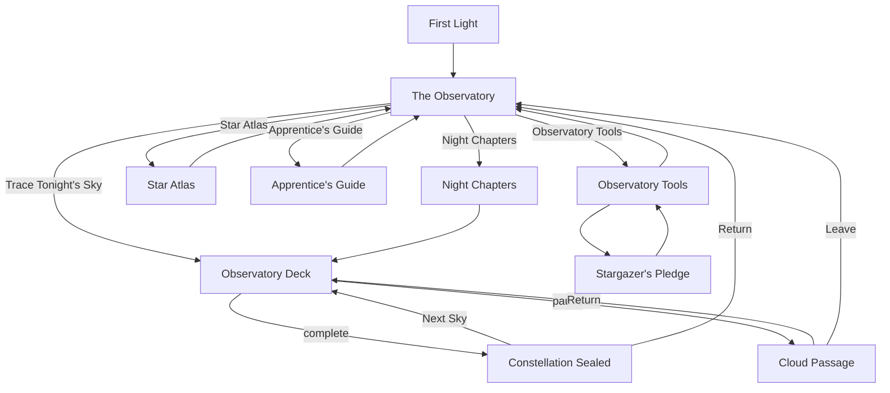

# Star Cartographer — Game Design Document

## Core Concept

**Star Cartographer** is a calm, offline constellation-tracing puzzle game. The player is an apprentice astronomer on a rooftop observatory, mapping stars into constellations by connecting them in the correct order. Each completed sky pattern unlocks an entry in a personal **Star Atlas** with a myth-inspired name and short flavor line.

The game feels like holding a brass sextant under a quiet night sky: deliberate, beautiful, and satisfying when the lines snap into place.

## Gameplay Loop

1. Choose a **Night Chapter** (level pack) or continue from the last unfinished sky.
2. Enter the **Observatory Deck** (gameplay screen). Stars appear on a dark sky; target stars pulse softly; decoy stars may glitter nearby.
3. **Trace** the constellation: press on star 1, drag through star 2, 3, … in order, release on the final star.
4. Correct sequence → lines lock in gold, brief celebration, myth name revealed → next sky or return to menu.
5. Wrong sequence mid-trace → current stroke dissolves; player retries without losing progress on already-locked segments (if any).
6. Completed constellations appear in the **Star Atlas** for review.

**Session length:** 1–3 minutes per constellation; 15–30 minutes for a full chapter of 5 skies.

## Play, Pause, and Resume

| State | Behavior |
|-------|----------|
| **Play** | Active tracing on the Observatory Deck. Drag input captured by Flame game layer. |
| **Pause** | Tap the **Brass Pause** control (top-right). Gameplay freezes: no input, timers stop, sky dimming overlay appears. |
| **Resume** | Tap **Return to the Sky** on pause overlay. Restores exact in-progress stroke state (partial trace preserved). |
| **Background** | App lifecycle pause (`AppLifecycleState.paused`) auto-pauses like manual pause. |
| **Quit mid-level** | Tap **Leave the Deck** on pause → confirm dialog → save level index and partial unlock progress locally; no data leaves device. |

No real-time pressure in v1: there is no countdown timer. Difficulty comes from star count, decoys, and sky rotation only.

## Level Structure and Progression

### Chapters (Night Chapters)

Progress is organized into **Night Chapters** — groups of 5 constellations each. v1 ships **3 chapters (15 constellations total)**.

| Chapter | Theme | New mechanic introduced |
|---------|-------|-------------------------|
| **Chapter I — First Light** | Apprentice basics | Ordered tracing, 4–6 stars, no decoys |
| **Chapter II — Wandering Stars** | Decoys appear | 6–8 stars, 2–3 decoy stars (untappable for sequence; tapping decoy gives gentle error feedback) |
| **Chapter III — Turning Skies** | Orientation shifts | 7–10 stars, decoys, whole constellation rotated 15°–90° |

### Constellation Data (v1)

Each level defines: `id`, `displayName`, `mythLine`, `stars[]` (x/y normalized 0–1, order index), `decoys[]` (optional), `rotationDegrees`.

**Chapter I — First Light**

1. **The Apprentice's Needle** — 5 stars, vertical line with slight curve. *"Every master cartographer began by finding true north."*
2. **The Silver Ladle** — 7 stars, dipper shape. *"Shepherds drank from it long before maps were drawn."*
3. **The Three Hearthstones** — 4 stars, triangle. *"Winter nights are warmer when you know where home sits in the sky."*
4. **The Lantern Bearer** — 6 stars, walking figure abstract. *"He climbs the eastern ridge each dusk with his lamp."*
5. **The Quiet Gate** — 5 stars, arch. *"Pass through only when the lines are true."*

**Chapter II — Wandering Stars**

6. **The Mourning Crown** — 5 stars + 2 decoys, W shape. *"She sits on her throne upside-down, waiting for dawn."*
7. **The River's First Bend** — 8 stars + 2 decoys, serpentine. *"Even the sky remembers where water once ran."*
8. **The Twin Watchers** — 6 stars + 3 decoys, two peaks. *"They never blink; they only drift with the seasons."*
9. **The Broken Harp** — 7 stars + 2 decoys. *"One string snapped; the music became silence."*
10. **The Cartographer's Signature** — 6 stars + 3 decoys, stylized S. *"Leave your mark so the next apprentice knows you passed."*

**Chapter III — Turning Skies**

11. **The Frost Crown** — 8 stars + 3 decoys, 45° rotation. *"Ice crystals pretend to be stars until you connect them."*
12. **The Drifting Canoe** — 9 stars + 3 decoys, 30° rotation. *"It slides across the sky without a ripple."*
13. **The Elder Compass** — 10 stars + 4 decoys, 60° rotation. *"Four points, yet only one path is correct."*
14. **The Last Ember** — 8 stars + 3 decoys, 75° rotation. *"The final spark before the sky goes dark."*
15. **The Master Chart** — 10 stars + 4 decoys, 90° rotation. *"When this map is complete, you are no longer an apprentice."*

### Unlock Rules

- Chapter I level 1 is always unlocked.
- Completing a constellation unlocks the next in sequence.
- Completing all 5 in a chapter unlocks the next chapter.
- Atlas entries unlock on completion (view anytime from main menu).

### Difficulty Scaling Summary

| Factor | Ch I | Ch II | Ch III |
|--------|------|-------|--------|
| Star count | 4–7 | 6–8 | 7–10 |
| Decoy stars | 0 | 2–3 | 3–4 |
| Rotation | 0° | 0° | 15°–90° |
| Hint pulse speed | slower | medium | faster (subtle) |

## Scoring and Win/Lose Conditions

### Win

Connect all stars in the correct order in a single continuous drag (release on final star). Partial segments from a previous failed attempt do not count; each successful completion is one clean trace.

**Star Score (per constellation):**

- **Base:** 100 points per star in the constellation.
- **Flawless Bonus:** +50 per star if completed with zero wrong strokes.
- **Chapter Bonus:** +200 on completing the 5th constellation in a chapter.

Display score on the **Constellation Sealed** overlay. Track **Lifetime Star Score** on the main menu and in Atlas header.

### Lose / Fail

There is no hard game-over. A **wrong stroke** (wrong star order, or releasing before final star) triggers:

- Stroke dissolves (animated fade).
- Soft error haptic + subtle system click.
- No score penalty; retry immediately.

If the player **Leaves the Deck** mid-constellation, progress on that specific sky is not saved as complete; they resume the same level next time.

## Screens

Every screen uses theme-native copy and code-drawn visuals only (see `DESIGN_LANGUAGE.md`). No generic "Play" or "Settings."

---

### 1. Splash — **First Light**

**Emotional beat:** Awakening; the sky is still dark.

**Layout (spatial):**

- Full-screen deep indigo gradient (horizon slightly lighter at bottom 15%).
- Center: a single pinprick star pulses (scale 0.8→1.2, 2s loop).
- At 1.2s: thin gold lines draw outward from the star, forming a tiny 3-point constellation (300ms stagger).
- Title **Star Cartographer** fades in above center (Cinzel, letter-spaced); subtitle *Apprentice of the Night Sky* below in smaller body size.
- At 2.8s total: cross-fade to main menu (no tap required). Skip if returning player and assets warm (optional fast path at 1.5s).

**Eye path:** pulse star → lines → title → transition up into sky.

---

### 2. Main Menu — **The Observatory**

**Emotional beat:** Standing on the rooftop; the whole sky is your map. Navigation should feel like choosing a region of the heavens, not tapping a button list.

**Layout (spatial — non-standard):**

- **Sky dome (top 72%):** Animated slow parallax drift of tiny background stars (procedural dots, 2 layers, different speeds). Constellation **navigation nodes** float in the sky as connected star clusters:
  - **Upper-left cluster:** *Trace Tonight's Sky* (continue / next uncompleted level) — brightest pulse.
  - **Upper-right cluster:** *Night Chapters* (chapter select) — 3 stars in a row icon.
  - **Lower-left cluster (near horizon):** *Star Atlas* — open book suggested by a flat trapezoid + star.
  - **Lower-right cluster:** *Apprentice's Guide* — small circled question mark star.
  - **Horizon center:** *Observatory Tools* (settings) — gear drawn as 6-point star shape, not a generic gear icon label.
- **Rooftop ledge (bottom 28%):** Dark silhouette trapezoid (observatory parapet). **Lifetime Star Score** etched on the ledge: *"Stars Charted: {count}/15"* and score number in gold.
- **Brass telescope** silhouette sits on the left edge of the ledge, pointing into the sky (pure `CustomPainter` path).

Tap targets: entire cluster hit area ~72×72 dp minimum, not just the dot.

**No vertical button stack.** Navigation is discovering stars in the sky.

---

### 3. Gameplay — **Observatory Deck**

**Emotional beat:** Focus; your finger is the pencil of light.

**Layout:**

- **Full-bleed sky canvas** (Flame `GameWidget`): gradient background, chapter-appropriate star field, interactive constellation stars.
- **Top HUD bar (safe area):** Left: constellation name (current myth working title or "Unknown Pattern" until complete). Center: progress dots (filled = stars connected this attempt). Right: **Brass Pause** (small octagon button).
- **Bottom hint strip (8% height):** Context text — *"Connect the stars in order"* / *"Star {n} of {total}"* — fades after 3s on level start.
- **Telescope vignette:** Subtle circular darkening at corners (code-drawn radial gradient overlay, non-interactive).

**Interaction:**

- Touch down on star 1 (highlight ring expands).
- Drag line follows finger; snap glow when hovering valid next star.
- Touch wrong star → stroke shatters, reset to star 1.
- Touch decoy → same error feedback; decoy flashes coral briefly.
- Complete → lines turn gold, locked; transition to **Constellation Sealed**.

---

### 4. Pause — **Cloud Passage**

**Emotional beat:** Brief rest; clouds pass over the moon.

**Layout (overlay on gameplay):**

- Semi-transparent indigo overlay (75% opacity) with slow horizontal cloud shapes (animated rects, 20% opacity white).
- Center card: rounded rectangle with thin gold border (not Material default).
  - Title: *Stargaze Pause*
  - Buttons (horizontal row, not vertical stack):
    - **Return to the Sky** (primary, gold fill)
    - **Leave the Deck** (secondary, outline)
- Game state frozen underneath.

---

### 5. Level Complete — **Constellation Sealed**

**Emotional beat:** Triumph; the myth is revealed.

**Layout:**

- Completed constellation drawn large in center (scaled up from gameplay positions).
- Gold locked lines animate with brief shimmer (opacity pulse once).
- Myth name in large Cinzel; flavor line in italic body below.
- **Star Score** breakdown: base + flawless bonus + chapter bonus if applicable.
- Actions:
  - **Next Sky** (if more in chapter) — primary
  - **Return to Observatory** — secondary
- Confetti: 12–20 tiny star particles burst outward (code-drawn, 1s).

---

### 6. Fail / Retry — **Fading Stroke**

Not a full screen — an inline feedback moment on the Observatory Deck:

- Wrong stroke fades over 400ms.
- Brief text flash near bottom: *"The line broke — trace again"* (auto-hide 1.5s).
- No separate game-over screen in v1.

---

### 7. Progression — **Night Chapters**

**Emotional beat:** Planning your journey across the sky.

**Layout:**

- Horizontal scroll of **chapter cards** (PageView or ListView horizontal).
- Each card: chapter name, 5 constellation slots (star icons — filled gold if complete, outline if locked), chapter bonus indicator.
- Locked chapters: card dimmed, small lock drawn as two arc lines (not Material lock icon required).
- Tap unlocked chapter → **Constellation Select** sub-view: vertical timeline of 5 entries with myth names; tap to play (must complete prior).

---

### 8. Star Atlas — **The Star Atlas**

**Emotional beat:** Your life's work on parchment made of sky.

**Layout:**

- Scrollable two-column grid (responsive: 1 column on narrow phones).
- Each cell: miniature constellation (same coordinate data, scaled), myth name, flavor line (2 lines max), score earned, flawless badge (small 6-point star if flawless).
- Locked entries: silhouette question-mark constellation.
- Header: total constellations sealed, lifetime score.

---

### 9. How to Play — **Apprentice's Guide**

**Emotional beat:** Mentor whispering instructions.

**Layout:**

- Parchment-colored panel (warm cream `#F0E6D3` on dark sky background) — code-drawn rounded rect, not an image.
- Illustrated steps using inline mini constellation diagrams (code-drawn, 3 steps):
  1. *Find the first pulsing star.*
  2. *Drag through each star in order without lifting wrongly.*
  3. *Release on the final star to seal the pattern.*
- Note on decoys: *"Some stars wander — they are not part of your chart."*
- Note on rotation: *"The sky turns; the order does not."*
- **Return to Observatory** at bottom.

---

### 10. Privacy — **Stargazer's Pledge**

**Emotional beat:** Trust; transparent and calm.

**Layout:**

- Simple scroll on dark background, cream text panel.
- Short copy (see Copy Sheet).
- **Return to Observatory** at bottom.

---

### 11. Observatory Tools — **Settings**

**Emotional beat:** Adjusting your instruments.

**Layout:**

- Slide-up panel from horizon (bottom 40%).
- Toggles:
  - **Hearth Haptics** (on/off) — vibration on trace events
  - **Deck Sounds** (on/off) — system sounds on tap/complete
- **Stargazer's Pledge** link → Privacy screen
- **Return to Observatory** dismiss

Persist toggles in `shared_preferences`.

---

## UI/UX Flow

## Audio and Haptic Feedback (v1)

| Event | Haptic | System Sound |
|-------|--------|--------------|
| Touch valid star | `selectionClick` | `click` |
| Complete constellation | `mediumImpact` | `alert` (if enabled) |
| Wrong stroke / decoy | `lightImpact` | none |
| UI navigation | `selectionClick` | `click` (if enabled) |

No audio files. Respects **Observatory Tools** toggles.

## Technical Notes (for implementers)

- **Engine:** Flutter 3.44 + Flame ^1.37.0.
- **Persistence:** `shared_preferences` — chapter progress, per-level completion, scores, settings toggles.
- **Coordinates:** Star positions stored normalized (0–1); scale to screen in Flame world with rotation applied around constellation centroid.
- **Package id suggestion:** `com.starcartographer.app` (confirm in setup phase).

---

## Copy Sheet

| String | Screen / Context | Function |
|--------|------------------|----------|
| Star Cartographer | Splash, About | App title |
| Apprentice of the Night Sky | Splash | Subtitle |
| The Observatory | Main menu | Main hub title (optional header) |
| Trace Tonight's Sky | Main menu | Start / continue primary action |
| Night Chapters | Main menu | Chapter select |
| Star Atlas | Main menu | Collection screen |
| Apprentice's Guide | Main menu | How to play |
| Observatory Tools | Main menu | Settings |
| Stars Charted: {n}/15 | Main menu | Progress summary |
| Observatory Deck | Gameplay | Screen context (debug/analytics-free label only) |
| Connect the stars in order | Gameplay hint | Tutorial hint |
| Star {n} of {total} | Gameplay HUD | Progress |
| Brass Pause | Gameplay | Pause button a11y label |
| Stargaze Pause | Pause overlay | Title |
| Return to the Sky | Pause | Resume |
| Leave the Deck | Pause | Quit to menu |
| The line broke — trace again | Gameplay | Error feedback |
| Constellation Sealed | Complete overlay | Title |
| Next Sky | Complete | Next level |
| Return to Observatory | Multiple | Back to main menu |
| Flawless Charting | Complete | Flawless bonus label |
| Star Score | Complete / Atlas | Score label |
| Lifetime Star Score | Menu / Atlas | Total score label |
| Night Chapter {n} | Chapters | Chapter title |
| Locked Chapter | Chapters | Locked state |
| Unknown Pattern | Gameplay | Unfinished constellation placeholder |
| Hearth Haptics | Settings | Haptic toggle |
| Deck Sounds | Settings | Sound toggle |
| Stargazer's Pledge | Settings / Privacy | Privacy link & title |
| Return to Observatory | Guide, Privacy, Settings | Back navigation |
| First Light | Chapter I name | Chapter title |
| Wandering Stars | Chapter II name | Chapter title |
| Turning Skies | Chapter III name | Chapter title |
| *(15 myth names)* | Atlas, Complete | Constellation names (see Level Structure) |
| *(15 flavor lines)* | Atlas, Complete | Myth descriptions (see Level Structure) |
