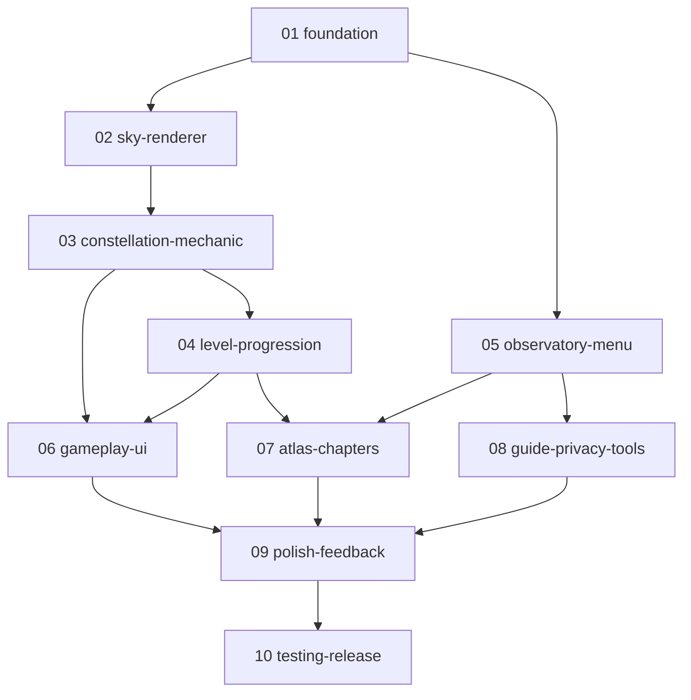

# Star Cartographer — Implementation Plan

Build **Star Cartographer** from empty folder to Play-Store-ready offline Flutter + Flame game by following phases in dependency order. Each phase has a self-contained brief in `docs/phases/`. Sub-agents update status here when done.

**Stack (pin in phase 01):** Flutter 3.44, Dart 3.12.0, flame ^1.37.0, shared_preferences ^2.5.5, hive_ce ^2.19.3 (only if needed — prefer shared_preferences alone for v1).

**Simplest-call rule:** One Flame game widget for gameplay; Flutter routes for menus; constellation data as a Dart const list; shared_preferences for all persistence.

## Phase List

| # | Slug | Summary | Depends on |
|---|------|---------|------------|
| 01 | `foundation` | Flutter + Flame scaffold, theme tokens, routing shell | none |
| 02 | `sky-renderer` | Night sky canvas, background stars, resize handling | 01 |
| 03 | `constellation-mechanic` | Star hit-test, drag trace, order validation, lock lines | 02 |
| 04 | `level-progression` | 15 constellation definitions, chapter unlocks, persistence | 03 |
| 05 | `observatory-menu` | Splash + spatial main menu (The Observatory) | 01 |
| 06 | `gameplay-ui` | HUD, pause overlay, seal complete, error feedback | 03, 04 |
| 07 | `atlas-chapters` | Star Atlas grid + Night Chapters select | 04, 05 |
| 08 | `guide-privacy-tools` | Apprentice's Guide, Stargazer's Pledge, Observatory Tools | 05 |
| 09 | `polish-feedback` | Haptics, system sounds, motion polish, design-language pass | 06, 07, 08 |
| 10 | `testing-release` | Manual test matrix, launcher icon, release checklist | 09 |

## Dependency Graph



**Parallel waves:**

- Wave 2 (after 01): **02** and **05** in parallel
- Wave 3 (after 02): **03**; **05** may still be finishing
- Wave 4 (after 03): **04**; **06** starts after 04
- Wave 5 (after 04 + 05): **07** and **08** in parallel
- Wave 6: **09** then **10**

## Status Table

| Phase | Name | Status | Notes |
|-------|------|--------|-------|
| 01 | foundation | pending | |
| 02 | sky-renderer | pending | |
| 03 | constellation-mechanic | pending | |
| 04 | level-progression | pending | |
| 05 | observatory-menu | pending | |
| 06 | gameplay-ui | pending | |
| 07 | atlas-chapters | pending | |
| 08 | guide-privacy-tools | pending | |
| 09 | polish-feedback | pending | |
| 10 | testing-release | pending | |

## Key Files (expected after all phases)

```
lib/
  main.dart
  app.dart
  theme/
    app_theme.dart
    app_colors.dart
    app_typography.dart
  data/
    constellation_levels.dart
    progress_repository.dart
  game/
    star_cartographer_game.dart
    components/
      sky_background.dart
      constellation_stars.dart
      trace_line.dart
  screens/
    splash_screen.dart
    observatory_menu_screen.dart
    gameplay_screen.dart
    pause_overlay.dart
    constellation_sealed_screen.dart
    night_chapters_screen.dart
    star_atlas_screen.dart
    apprentice_guide_screen.dart
    privacy_screen.dart
    observatory_tools_screen.dart
  widgets/
    gold_button.dart
    sky_navigation_cluster.dart
    atlas_cell.dart
assets/
  fonts/
    Cinzel-Regular.ttf
    Cinzel-SemiBold.ttf
```

## Next Step

Run **`game-setup`** to scaffold the Flutter project, then **`game-build`** starting at phase 01.
